<!--
  AUTO-GENERATED by scripts/ui-capture/gallery.mjs (family template).
  Do not edit by hand — re-run the capture script to regenerate.
  To add a page, add a scene in scripts/ui-capture/scenes.mjs.
-->

# Desktop Assistant — Visual Tour

Welcome to the visual tour of Desktop Assistant. These reproducible screenshots showcase the app's windows and flows as a storyboard — type, send, watch a tool run, open the palette, use a mini app, then open the desktop window — captured from the real running application (demo mode, scripted local assistant and search) over the DevTools protocol, with a transparent background so the rounded windows composite onto any page.

> Mobile views: not captured this run — pass `--viewport mobile` to `./scripts/capture_ui.sh` to generate.

## Launcher

### launcher-ask

_Ask from the launcher — type, send, and the answer streams in place._

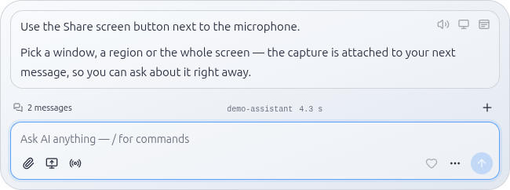

#### Storyboard

_5 frames in order._

**Type the question.**

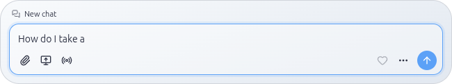

**The composer grows with the draft.**

**Send — the turn starts in place.**

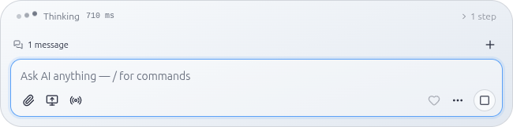

**The answer streams into the launcher.**

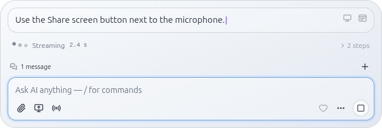

**Done — the answer, the conversation meta and the composer stay in one place.**

## Tools

### launcher-search

_Tools — a web search runs with visible steps, then the answer cites its sources._

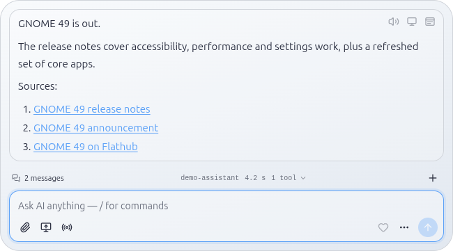

#### Storyboard

_5 frames in order._

**Ask a question that needs the web.**

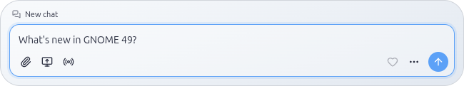

**Send — the trace strip shows the live turn.**

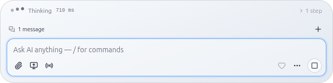

**web_search runs — one visible step, no hidden magic.**

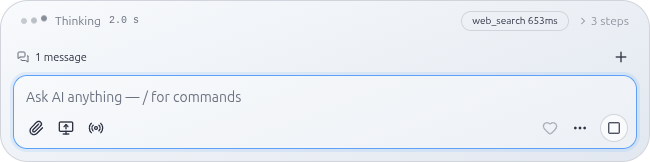

**The answer lands with its sources.**

**Open the trace: the search query and every step are inspectable.**

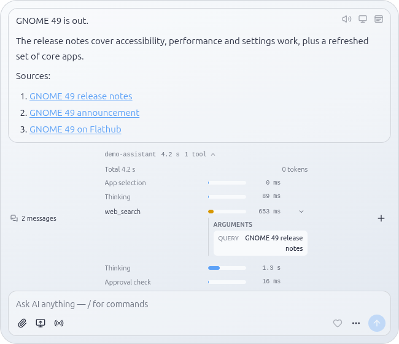

## Commands

### command-palette

_Slash commands — the palette opens from the composer and filters as you type._

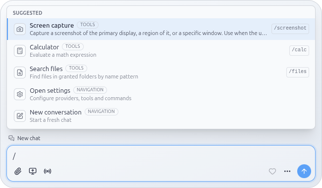

#### Storyboard

_2 frames in order._

**Type / to open the palette.**

**Keep typing to filter.**

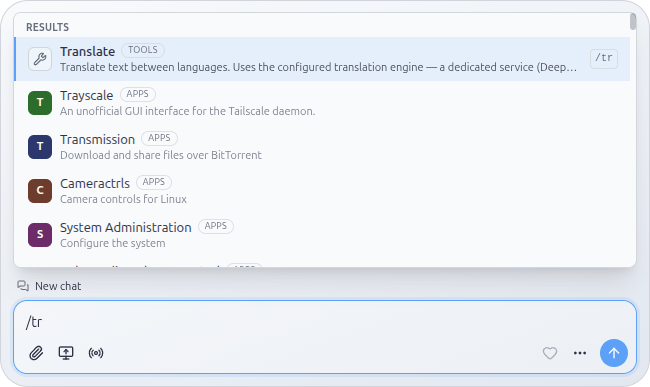

## Mini apps

### launcher-calc

_Mini apps — the calculator evaluates live as you type._

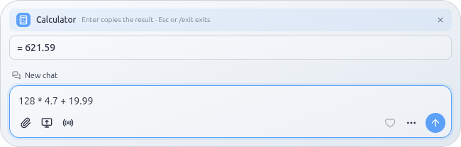

#### Storyboard

_2 frames in order._

**Open the calculator with /calc.**

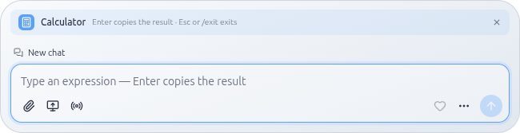

**The result updates live.**

### launcher-translate

_Mini apps — the translate pad renders a live translation._

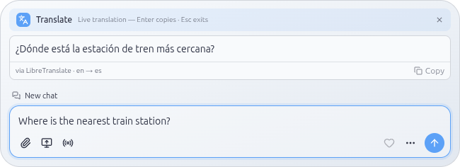

#### Storyboard

_2 frames in order._

**Open the translate pad with /tr.**

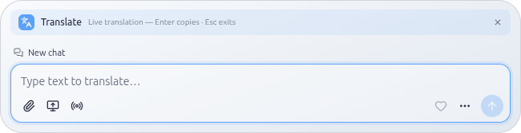

**Live translation, local demo engine.**

## Desktop

### desktop-tools

_Desktop window — the full conversation with tool steps and artifacts._

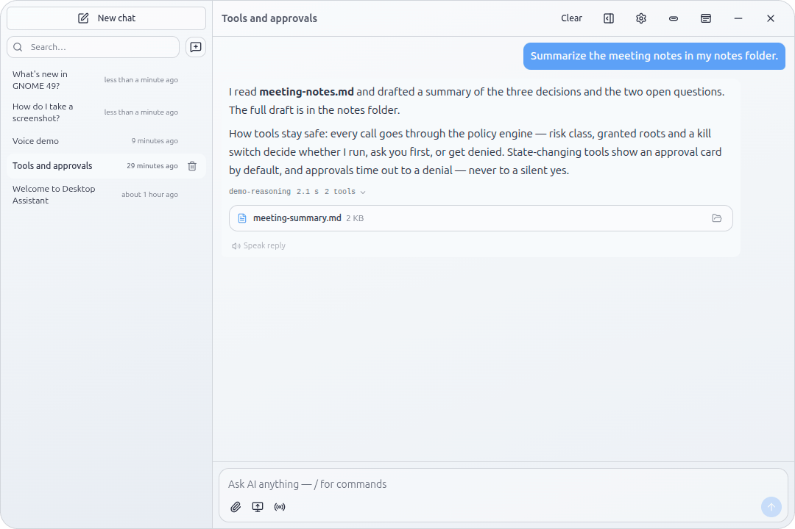

## Settings

### settings-ai

_Settings — the AI tab: configured providers, models and task assignments, plus the preset catalog for every supported service._

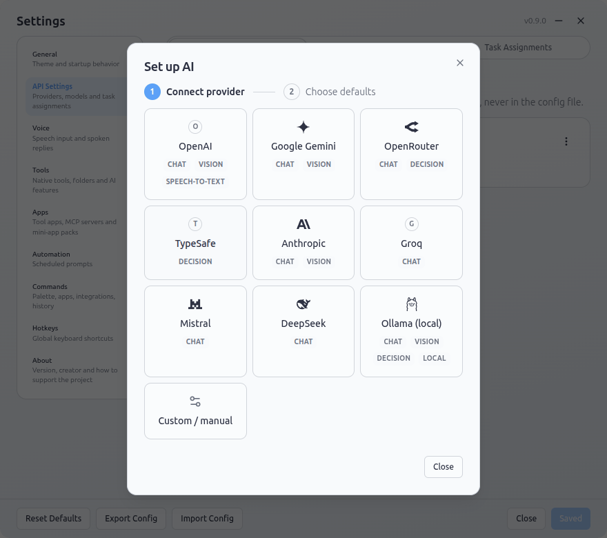

#### Storyboard

_2 frames in order._

**AI settings — configured providers and the default model.**

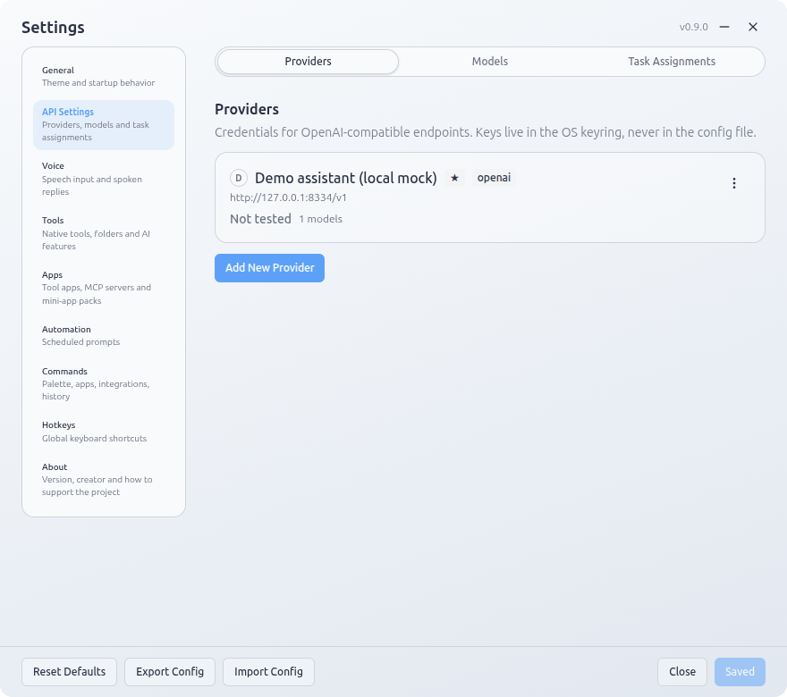

**Add a provider — presets for every supported service, hosted or local.**

